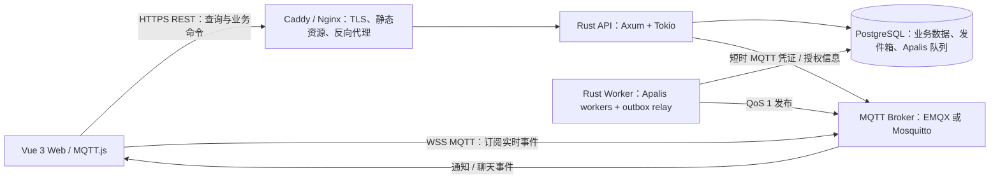

# Rust + PostgreSQL + Apalis 任务发布与接单系统架构设计

## 1. 目标、范围与设计结论

目标是在 Debian 上运行一个由 Vue 前端和 Rust 后端组成的小规模委托平台，支持发布、接单、积分托管与结算，并通过 MQTT 提供实时通知和聊天消息分发。

首期包含：

- 用户、基础角色与权限。
- 委托创建、发布、浏览、接单、开始、提交完成、发布者验收。
- 内部积分账户、报酬托管、流水审计、验收发放和取消/过期退款。
- 任务参与者之间的聊天与任务状态通知。
- 操作记录、审计日志、后台异步作业。

积分是不可提现、不可自由转让的站内记账单位；首期不包含外部支付、复杂评价/争议流程、微服务、Kubernetes、多区域部署。

**推荐基线：**

1. 采用模块化单体，而不是微服务。一个 Rust 代码库、一个 PostgreSQL 主库；API 和后台 worker 可由同一二进制以不同运行模式启动。
2. REST API 是所有业务写入的唯一入口；PostgreSQL 是任务、用户和聊天记录的权威事实源。
3. MQTT 用于实时通知与聊天事件分发，不承载权威委托/积分状态，不作为聊天记录的唯一存储。
4. 通过 PostgreSQL 事务发件箱保证“业务提交后最终发送事件”；Apalis 负责可重试的后台作业。
5. 业务表和字段使用加引号的中文 PostgreSQL 标识符；HTTP JSON 响应与 MQTT 事件属性使用中文业务字段名，请求入参和第三方协议字段按既有协议保留英文名称。

委托聊天复用群聊存储与消息 API：接单和委托群创建/成员加入处于同一事务；发布者为群主，当前接单者为成员，释放后撤销接单者成员身份。群聊使用 `"群_群组"."关联任务编号"` 标识委托群；普通群、好友私聊和委托群在统一消息列表中区分。好友私聊、普通群聊和委托群消息均通过 HTTP 写入并由 API 在数据库事务中持久化，HTTP 成功响应表示消息已保存。MQTT 只负责后端发件箱提交后的实时扇出。Vue 应用全局只建立一条 MQTT 连接，并按事件类型分发任务状态通知、好友私聊、群聊和其他通知。

历史迁移会把已接单委托的 `"聊天消息"` 复制至对应 `"群_消息"`，旧消息对发布者保留可见、对接单者隐藏；旧表暂不删除，以便回滚及归档。接单者每轮加入时的可见起始序号设置为群当前最后序号加一，避免跨接单轮次泄漏历史内容。

## 2. 总体架构



### 组件与边界

| 组件 | 职责 | 不应承担的职责 |
|---|---|---|
| Vue 3 + TypeScript | 页面、表单校验、REST 请求、MQTT 订阅、断线重连和未读提示 | 自行决定任务状态、信任本地角色信息 |
| Caddy 或 Nginx | HTTPS/WSS、静态资源、反向代理、请求大小限制 | 业务鉴权或任务状态流转 |
| Rust API（建议 Axum + Tokio） | 身份认证、权限校验、业务规则、事务、REST、签发 MQTT 短时凭证 | 长耗时任务同步执行 |
| PostgreSQL | 用户、任务、聊天记录、审计/事件、事务发件箱、队列持久化 | 实时推送连接管理 |
| Apalis worker | 通知发送、过期扫描、提醒、清理等可重试后台任务 | 取代数据库事务或作为业务事实源 |
| MQTT Broker | 连接管理、主题订阅授权、实时扇出 | 未经后端校验就修改任务，或永久保存聊天记录 |

建议代码按领域模块组织，而不是一开始拆成多个服务：

```text
应用
├── 身份与权限
├── 用户
├── 任务
├── 接单与状态流转
├── 聊天与通知
├── 发件箱与事件
├── 后台作业（Apalis）
└── 基础设施（配置、数据库、MQTT、日志）
```

## 3. 关键请求与事件链路

### 发布任务

1. 前端经 HTTPS 调用 `POST /api/v1/tasks`，携带访问令牌和幂等键。
2. API 校验用户状态、字段、权限和限流规则。
3. 在同一数据库事务中锁定发布者积分账户、校验可用余额、写入委托与报酬快照，并从可用积分转入冻结积分；同时写入状态事件和事务发件箱记录。
4. 事务提交后立即返回任务 ID；后台 relay 后续发布 `task.created` MQTT 事件。
5. 若 MQTT 暂时不可用，任务仍然成功创建；发件箱保留待重试事件。

### 接单（并发安全）

接单必须使用 PostgreSQL 原子条件更新，不能采用“先查询仍待接单，再无条件更新”的两步写法。

```sql
UPDATE "任务"
SET "任务状态" = '已接单',
    "接单者编号" = $1,
    "接单时间" = now(),
    "版本号" = "版本号" + 1,
    "更新时间" = now()
WHERE "任务编号" = $2
  AND "任务状态" = '待接单'
  AND "发布者编号" <> $1
RETURNING "任务编号", "发布者编号", "接单者编号";
```

只有一个并发请求能更新成功；零行返回表示任务不存在、已被接单、已取消/过期，或用户不能接自己的任务。更新、状态历史、审计与发件箱写入必须在同一事务中完成。使用请求幂等键避免客户端超时重试造成重复操作。

### MQTT 投递与离线恢复

1. API 事务提交后，relay/worker 从发件箱读取待发事件并发布到 MQTT。
2. MQTT 使用 QoS 1；发件箱只在收到 broker 确认后标记已发送。
3. 若 broker 已收到消息但 worker 在记录确认前崩溃，消息会再次发送。因此消费者应按 `event_id` 去重；系统语义是**至少一次**，不是端到端恰好一次。
4. MQTT 断线期间前端通过 REST 查询当前任务/消息及游标后的更新补齐状态。不能假设客户端一直在线或 broker 会永久保存所有消息。
5. 委托群聊、好友私聊和普通群聊均以 HTTP 响应作为发送确认；HTTP 写入成功后，事务发件箱异步发布对应 MQTT 事件。群消息发送在一个事务内递增群内序号、保存消息并为所有有效成员创建个人通知 outbox。

## 4. 任务状态机与业务规则

建议状态值使用稳定的 ASCII 字符串（数据库字段名可中文），由业务层集中定义和校验；数据库再以 `CHECK` 约束保护非法状态。

```text
草稿 --发布/托管积分--> 待接单 --接单--> 已接单 --开始--> 进行中 --提交完成--> 待验收 --发布者验收/发放积分--> 已完成
                       |                    |
                       +--发布者取消--> 已取消
                       +--超时过期----> 已过期
                                            +--发布者取消（未开始）--> 已取消
```

首期规则建议：

- 发布者只能接单以外的用户接自己的任务；同一个任务最多一位当前接单者。
- 发布者可取消“待接单”任务；已接单但尚未开始时也可取消，并在同一事务中通知接单者。
- 接单者在尚未开始时可主动释放任务，任务回到“待接单”，并记录接单历史；需明确是否允许再次被同一用户接单。
- 发布时冻结整数积分；接单者完成后仅进入“待验收”，发布者验收后同一事务内将冻结积分发给接单者。
- 未开始的委托取消或待接单委托过期时，冻结报酬同一事务退回发布者；已开始委托不能单方取消。
- 历史无报酬委托保持报酬为空，不允许接单；已在迁移前接单的旧委托仍可完成，但没有积分发放。
- “进行中”任务首期不允许单方直接取消；争议或强制取消走运营处理/人工流程，避免缺少规则时误删业务事实。
- “已完成”“已取消”“已过期”均为终态。若将来要重开，创建明确的管理操作及审计事件，而非直接改写历史。
- 所有状态改变都经过同一个领域服务，校验当前状态、操作者、时间边界和版本号；前端隐藏按钮不构成权限控制。

若产品需要“接单申请、发布者挑选接单人”，应将“申请”和“确认接单”作为独立流程，不要复用上述直接接单语义。

## 5. 数据模型与中文标识符约定

### 核心实体

| 表（建议名称） | 核心字段（建议名称） | 说明 |
|---|---|---|
| `"用户"` | `"用户编号"`、`"登录名"`、`"密码摘要"`、`"昵称"`、`"账号状态"`、`"创建时间"` | 登录名/手机号等按实际登录方式设置唯一约束；密码存 Argon2id 摘要，不存明文 |
| `"角色"` | `"角色编号"`、`"角色名称"` | 首期可有普通用户、运营员、管理员 |
| `"用户角色"` | `"用户编号"`、`"角色编号"` | 多对多关系；普通用户可同时发布和接单 |
| `"任务"` | `"任务编号"`、`"发布者编号"`、`"接单者编号"`、`"标题"`、`"描述"`、`"任务状态"`、`"截止时间"`、`"接单时间"`、`"版本号"` | 当前状态和当前接单人；任务历史另存事件表 |
| `"积分账户"` | `"账户编号"`、`"用户编号"`、`"账户类型"`、`"可用积分"`、`"冻结积分"` | 用户余额账户和系统发行账户；积分为整数 |
| `"积分交易"` | `"交易编号"`、`"交易类型"`、`"来源账户编号"`、`"目标账户编号"`、`"积分数量"`、`"委托编号"`、`"请求幂等键"` | 每次账户/余额类型之间的不可变转移记录 |
| `"积分流水"` | `"交易编号"`、`"账户编号"`、`"可用变动"`、`"冻结变动"`、`"可用余额"`、`"冻结余额"` | 每笔交易的账户变动及交易后余额快照，追加式审计 |
| `"委托报酬"` | `"委托编号"`、`"发布者编号"`、`"接单者编号"`、`"积分数量"`、`"结算状态"` | 委托唯一报酬快照，状态为托管中/待验收/已发放/已退款 |
| `"任务事件"` | `"事件编号"`、`"任务编号"`、`"操作者编号"`、`"事件类型"`、`"原状态"`、`"新状态"`、`"发生时间"`、`"请求幂等键"` | 追加写入，支持审计、故障排查和状态重建 |
| `"聊天会话"` | `"会话编号"`、`"任务编号"`、`"创建时间"` | 旧委托聊天模型；待历史归档及客户端迁移完成后清理 |
| `"聊天消息"` | `"消息编号"`、`"会话编号"`、`"发送者编号"`、`"客户端消息编号"`、`"消息正文"`、`"创建时间"` | 旧委托聊天历史；迁移只回填执行迁移时仍有接单者的委托，因此暂不可删除 |
| `"事务发件箱"` | `"事件编号"`、`"事件类型"`、`"主题"`、`"事件内容"`、`"投递状态"`、`"重试次数"`、`"下次尝试时间"`、`"创建时间"` | 与业务数据在同一个数据库事务中写入 |

例子中的中文名称是设计约定，落地前应验证驱动、ORM、迁移、备份和运维工具兼容性。PostgreSQL 支持 UTF-8 加引号标识符，但这些名字在 SQL 中必须始终正确引用；未加引号的标识符会折叠为小写。标识符受字节长度限制，中文字符通常占多个字节，名称应短而稳定。

核心 DDL 示意（省略外键索引、审计列和权限细节；生产迁移需逐项补齐）：

```sql
CREATE TABLE "用户" (
    "用户编号" uuid PRIMARY KEY,
    "登录名" text NOT NULL UNIQUE,
    "密码摘要" text NOT NULL,
    "昵称" text NOT NULL,
    "账号状态" text NOT NULL CHECK ("账号状态" IN ('正常', '禁用')),
    "创建时间" timestamptz NOT NULL DEFAULT now()
);

CREATE TABLE "任务" (
    "任务编号" uuid PRIMARY KEY,
    "发布者编号" uuid NOT NULL REFERENCES "用户" ("用户编号"),
    "接单者编号" uuid REFERENCES "用户" ("用户编号"),
    "标题" text NOT NULL,
    "描述" text NOT NULL,
    "任务状态" text NOT NULL CHECK (
        "任务状态" IN ('草稿', '待接单', '已接单', '进行中', '已完成', '已取消', '已过期')
    ),
    "截止时间" timestamptz,
    "接单时间" timestamptz,
    "版本号" integer NOT NULL DEFAULT 0,
    "创建时间" timestamptz NOT NULL DEFAULT now(),
    "更新时间" timestamptz NOT NULL DEFAULT now(),
    CHECK ("接单者编号" IS NULL OR "接单者编号" <> "发布者编号")
);

CREATE INDEX "任务_待接单_创建时间_idx"
    ON "任务" ("创建时间" DESC)
    WHERE "任务状态" = '待接单';
```

### 中文代码与跨系统边界

- Rust 允许 Unicode 标识符，但数据库驱动、过程宏、生成代码、Shell、监控和团队搜索工具对中文支持可能不一致。不要强求所有代码和依赖符号都汉化。
- 推荐领域说明、注释、错误信息使用中文；领域层可在经过编译和工具链验证后使用中文类型/函数名，或使用清晰拼音（如 `renwu`、`jie_dan`）。框架、crate、协议、配置项沿用原有英文名。
- Rust 结构体和字段可直接采用中文标识，使数据库字段名与 HTTP JSON 响应字段保持一致；第三方协议结构按协议要求保留原字段名：

```rust
#[derive(serde::Serialize)]
struct 任务响应 {
    任务编号: uuid::Uuid,
    任务状态: String,
}
```

- HTTP JSON 响应使用中文数据库字段及中文业务属性（例如认证响应中的 `访问令牌`、`用户编号`，任务响应中的 `任务编号`、`任务状态`）；HTTP 请求体和查询参数继续使用兼容现有客户端的英文键名。MQTT 主题和事件类型保留 ASCII 拼音/英文（如 `renwu/{id}/events`、`task.status_changed`），事件 JSON 属性使用中文。JWT 标准声明及 EMQX ACL claim 仍须使用协议规定的英文键名。
- 本项目按中文优先要求将数据库名设为 `"任务平台"`，连接 URI 中须对 UTF-8 数据库名做百分号编码；创建、备份/恢复、监控和脚本均须验证 Unicode 名称兼容性。如果具体运维工具不支持，可退回 `renwu` 等拼音数据库名，同时保留中文业务表/字段。数据库角色和基础设施对象可用拼音；Apalis 自身管理的队列表、列及迁移保持库默认命名，不要手工改名。

## 6. REST API 与权限边界

建议所有业务变更使用版本化 REST API：

| 方法与路径 | 用途 | 关键权限 |
|---|---|---|
| `POST /api/v1/tasks` | 创建/发布任务 | 已登录；发布者为当前用户 |
| `GET /api/v1/tasks` | 分页浏览/筛选任务 | 按可见性过滤；游标分页 |
| `GET /api/v1/tasks/{id}` | 查询详情 | 公开字段与参与者私有字段分开 |
| `POST /api/v1/tasks/{id}/claim` | 接单 | 登录、非发布者、任务仍待接单 |
| `POST /api/v1/tasks/{id}/start` | 开始任务 | 仅当前接单者，状态为已接单 |
| `POST /api/v1/tasks/{id}/complete` | 完成任务 | 仅当前接单者，状态为进行中 |
| `POST /api/v1/tasks/{id}/accept-completion` | 验收并结算 | 仅发布者，状态为待验收；冻结报酬转入接单者可用余额 |
| `POST /api/v1/tasks/{id}/cancel` | 取消任务 | 按上述取消规则校验 |
| `POST /api/v1/tasks/{id}/release` | 接单者释放任务 | 仅当前接单者且尚未开始 |
| `GET /api/v1/tasks/{id}/group-chat` | 查询委托关联群组 | 当前委托群有效成员 |
| `GET/POST /api/v1/groups/{id}/messages` | 拉取/发送群消息 | 群有效成员；发送支持幂等编号 |
| `POST /api/v1/realtime/credentials` | 获取短时 MQTT 凭证 | 登录；仅授权订阅允许的主题 |
| `GET /api/v1/my/points` | 查询积分余额 | 登录；仅返回当前用户账户 |
| `GET /api/v1/my/points/ledger` | 查询积分流水 | 登录；仅返回当前用户账户流水 |
| `POST /api/v1/admin/users/{id}/points` | 管理员/运营员发放积分 | 角色授权、正整数上限、幂等键和操作审计 |

接单、取消、开始、完成等命令可要求 `Idempotency-Key`；需要并发编辑的资源支持 `版本号`/ETag。列表接口使用游标分页和明确的默认排序，不使用无上限的 offset。每次请求均由服务端校验身份、资源归属、状态转换和角色；普通用户不能因为伪造 MQTT 消息而变更任务。

## 7. MQTT、通知与聊天

### 主题与事件

主题使用不含姓名、手机号等个人信息的 ASCII 命名。示例：

```text
renwu/{任务编号}/events
renwu/users/{用户编号}/notifications
```

任务状态事件使用 `renwu/{任务编号}/events`；好友私聊及普通群聊/委托群的消息和邀请事件发往相应用户的 `renwu/users/{用户编号}/notifications`。群聊按有效成员向个人主题扇出，使浏览器 ACL 不必订阅任意群主题；普通群人数上限为 100。旧主题 `renwu/{任务编号}/messages` 和旧 MQTT 请求订阅仅用于过渡兼容，当前委托消息不再从该路径写入。订阅和发布 ACL 必须按当前登录用户与会话成员权限约束。浏览器只订阅后端签发的主题，不直接向 MQTT 发布聊天内容；客户端不得订阅任意通配符主题。成员退出或被移除后，不再为其创建后续群消息 outbox。角色撤销、任务取消或会话权限变化时，应通过短时令牌过期、重新授权或断开连接使旧权限失效。

事件使用版本化 JSON，例如：

```json
{
  "事件编号": "uuid",
  "事件类型": "task.status_changed",
  "结构版本": 2,
  "发生时间": "RFC3339",
  "任务编号": "uuid",
  "数据": {
    "任务状态": "已接单"
  }
}
```

避免在主题或事件中放入口令、访问令牌、完整个人资料或不必要的任务描述。MQTT 不发布“控制类”业务命令。委托群聊、好友私聊和普通群聊先经 HTTP 完成身份/参与关系校验、内容校验、幂等处理并持久化，再通过事务发件箱通知参与者；HTTP 成功仅表示数据库已接受消息，实时推送由 MQTT 异步完成。群聊历史按群内序号 keyset 分页；新成员的可见起始序号设为加入时最后序号加一。

### Broker 与传输安全

- 浏览器仅通过 WSS 连接 broker，API 仅通过 HTTPS；内部服务连接使用受保护网络。
- 小型 Debian 部署可选择 Mosquitto（资源轻、规则较简单）或 EMQX（认证/授权能力更丰富）；结合实时连接数、JWT/ACL 集成和运维能力选择，不要同时引入两个 Broker。
- 使用短时 MQTT 凭证/令牌，限制允许的主题和操作；禁止匿名访问、全局 `#` 订阅和客户端发布任务状态事件。
- 任务状态通知通常不设 retained，聊天消息不设 retained。将 MQTT QoS 1 视为至少一次传递；客户端用 `event_id` 去重，并在重连后从 REST 补拉。
- 为 MQTT 连接、消息大小、订阅数和发布频率设置上限；Broker 与数据库均需监控磁盘、连接数和队列积压。

## 8. Apalis、事务发件箱与后台作业

建议首期后台作业包括：

- 发件箱 relay：批量锁定待投递事件、发布 MQTT、记录确认/重试。
- 任务过期扫描：定时将已过截止时间且仍待接单的任务转为已过期，并写状态事件/发件箱。
- 提醒、通知和可延迟的清理任务。

**事务发件箱是可靠事件发布的关键。** 业务行和发件箱行在同一个 PostgreSQL 事务内提交；relay 将事件发往 MQTT 后再标记完成。Apalis 队列和业务事务之间是否能共享同一个数据库事务，取决于所选 Apalis/PostgreSQL 集成的具体 API 和版本，不应默认它们自动原子。若不能共享事务，不要先提交任务再只依赖“单独 enqueue 一个 Apalis job”来保证事件不丢；让可恢复的 worker 周期性扫描发件箱。

Apalis PostgreSQL 存储及其 feature/迁移要求应在选定版本后核实。若选择与业务表共用数据库，保持队列表和业务表迁移边界清楚，使用独立应用数据库角色或尽可能收紧权限，并给 worker 连接池设上限。作业应支持幂等、超时、有限重试与指数退避；持续失败进入可观测的失败队列/人工处理流程，不可无限快速重试。

## 9. Debian 部署与运行

### 小规模单机形态

```text
Debian 主机
├── Caddy/Nginx（80/443、HTTPS/WSS、静态前端）
├── Rust API systemd 服务
├── Rust Apalis worker systemd 服务（可同二进制不同参数）
├── PostgreSQL（仅本机/私网可访问，持久磁盘）
└── 单一 MQTT Broker（仅开放 WSS/内网所需端口）
```

前后端可分别构建：Vue 静态文件由反向代理提供；Rust release 二进制由 `systemd` 管理。API 与 worker 初期同机但分开进程，便于独立重启、资源限额和后续拆开部署。仅暴露 HTTPS/WSS；数据库和 broker 管理端口不得对公网开放。使用专用 Linux 用户运行服务、只读配置/密钥权限、systemd 自动重启与资源限制。

也可以容器化，但需明确数据库数据卷、升级顺序、健康检查、密钥注入和备份恢复；不要把容器删除/重建当作数据库备份。生产凭证不写入镜像、仓库或普通日志。

### 配置、迁移与可观测性

- 配置通过环境变量或权限受限配置文件注入：数据库连接、MQTT 地址、令牌密钥、队列并发数、日志等级等。开发、测试、生产配置分离。
- 使用版本化、可审阅的数据库迁移；发布时先做备份，确认迁移兼容，再滚动或按顺序重启 API/worker。避免不可逆的大表锁迁移。
- 使用结构化日志与 `tracing`，为请求、任务、事件和作业记录关联 ID；敏感字段脱敏，禁止记录密码、令牌和完整会话凭证。
- 监控 API 错误率/延迟、数据库连接池等待和慢查询、worker 成功率/重试/积压、发件箱最老事件年龄、Broker 在线连接数/断开数/磁盘和系统磁盘空间。
- 定期备份 PostgreSQL；小规模先采用加密的异机备份，并定期执行恢复演练。仅有备份文件但未验证恢复不算可靠备份。

## 10. 安全与可靠性基线

- 密码用 Argon2id 等专用口令哈希；登录限速，访问令牌短时有效，刷新令牌轮换并可撤销。
- RBAC 与资源归属检查同时使用：角色能做什么，仍需验证用户是否为任务发布者/接单者/会话参与者。
- 所有输入做长度、格式和大小限制；富文本/文件上传若以后加入，应单独设计内容安全、存储和扫描。
- 使用 TLS、CORS 白名单、适当的安全响应头、请求体大小限制、登录/接单/发消息限流；若使用 Cookie 凭证，处理 CSRF。
- 数据库账号最小权限，生产与迁移凭证分离；备份加密，密钥不与备份存放在同一未保护位置。
- 对任务状态、权限变化、接单、取消、管理操作保留审计记录；消息内容按业务隐私和保留策略管理。
- 依赖采用锁文件固定；CI 至少运行格式检查、Clippy、单元/集成测试、迁移检查和依赖漏洞扫描。

## 11. 测试与验收要点

1. 并发测试：多个用户同时接单同一任务，最终恰好一个成功，数据库只存在一个当前接单者。
2. 状态机测试：所有允许/禁止的角色与状态组合均有测试；终态不能被普通命令改写。
3. 幂等测试：同一请求键重复提交不会重复创建任务、接单事件或聊天消息。
4. 发件箱故障测试：数据库提交后停止 MQTT/worker，恢复后事件仍被投递；模拟确认后崩溃时消费者可去重。
5. MQTT 授权测试：普通用户不能订阅不相关用户/任务/会话主题，也不能发布状态事件。
6. 断线恢复测试：客户端重连后 REST 补拉可恢复任务状态和消息，不依赖 retained 消息。
7. 迁移/恢复测试：从空数据库创建、升级迁移，并在隔离环境从备份恢复。
8. 中文标识符工具链测试：目标 Rust SQL 驱动/SQLx、迁移工具、查询工具、备份/监控脚本对表名、列名、转储和恢复均正常。

## 12. 可优化方向（按优先级与触发条件）

### P0：首发前优先完成

- **接单正确性**：原子条件更新、事务、唯一约束、幂等键和并发测试。
- **通知可靠性**：事务发件箱、失败重试、事件 ID 去重、REST 离线补偿。
- **权限与 MQTT ACL**：先实现最小授权范围；不要用“主题难猜”代替鉴权。
- **数据库标识符试点**：先用一个中文表完成完整迁移、测试、备份/恢复、SQLx 映射试验，再决定是否全库中文。若任何工具链受阻，保留中文注释和业务展示名，表字段使用清晰拼音，避免高风险强推。
- **分页、索引和数据保留**：任务列表游标分页、必要索引、日志/消息留存策略。

### P1：出现增长或运维压力后

- 将 API 与 worker 独立扩容；增加连接池/并发作业限制，按监控数据调整，不直接盲目加并发。
- 按实际查询加索引、优化慢查询；有明显读压力后再考虑只读副本，注意副本延迟下的读取一致性。
- 消息量增长后按时间归档/分区，并制定清晰保留期限；先测量再分区，避免过早引入复杂维护。
- 将对象文件（若后续支持附件）放到对象存储，不把大文件塞入 PostgreSQL 或 MQTT。
- API 规范、OpenAPI 生成和前端客户端代码生成；为事件 payload 做 schema 版本管理。

### P2：规模或可用性目标明确后

- 多实例部署、负载均衡、独立 PostgreSQL/Broker 主机、连接池代理、高可用与灾备。
- 多 Broker/多节点、消息桥接或 Kafka 等流平台，仅在 MQTT 扇出、跨域集成或事件分析确有需求时考虑。
- 微服务拆分仅在团队所有权、独立发布、故障隔离或扩容边界真实存在后进行；首期拆分会增加事务、部署和排障复杂度。
- 定义 RPO/RTO、灾备地域和恢复演练频率，再决定数据库复制、自动故障切换和多机房方案。

### 不建议首期引入

- Redis：当前 PostgreSQL 足以承担权威数据、幂等与持久队列；除非测量证明缓存/临时协调成为瓶颈。
- Kubernetes、微服务、分布式事务、Kafka：小规模单体阶段通常增加复杂度，不能替代正确的事务、幂等和监控。
- 所有 Rust 标识符及全部协议字段强制中文：中文数据库可以试点，但把生态边界也汉化会增加工具、SDK、日志查询和集成摩擦。

## 13. 落地顺序

1. 先定取消/释放规则、任务可见性、登录方式、聊天保留期限及部署恢复目标。
2. 验证中文数据库标识符与 SQLx、迁移、备份恢复全链路；同时确定 Apalis PostgreSQL 存储所需版本与迁移。
3. 建数据库迁移、身份权限、任务状态机、接单并发与幂等测试。
4. 完成事务发件箱、Apalis worker、通知事件和 MQTT ACL。
5. 完成 Vue 页面、WSS 订阅、断线补拉和聊天持久化。
6. 建立 Debian systemd/反向代理部署、监控、备份与恢复演练，再开放生产流量。
